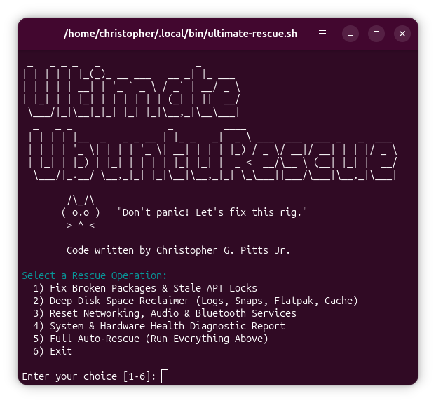

# Ultimate Ubuntu Backup

An interactive system snapshot, personal data backup, and migration toolkit for Ubuntu 26.04+—part of **The Ultimate Ubuntu Suite**.



## Features
- **System Snapshots (Timeshift):** Plain-English guided setup offering either a quick on-demand terminal RSYNC save point or the graphical Timeshift wizard for picking drives and schedules.
- **1-Click Software Reinstaller:** Exports your manually installed APT, Flatpak, and Snap apps alongside a standalone `restore-apps.sh` script.
- **Personal Files & GNOME Settings:** Backs up your desktop layout, keybindings (`dconf`), custom scripts, `.desktop` shortcuts, SSH keys, and optional `~/Documents` and `~/Downloads` folders with upfront size/speed notes.
- **Auto USB Detection:** Automatically finds mounted external drives under `/media/$USER/` so you can export a complete migration bundle straight to a thumb drive.
- **Guided Restore:** Step-by-step confirmation prompts let you safely restore files, desktop settings, and apps without accidental overwrites.

## Installation & Quick Start

### Option 1: Instant Run (No Download Needed)
Run directly in your terminal right when you need a backup or restore:
```bash
bash <(wget -qO- [https://raw.githubusercontent.com/kintaris3/Ultimate-Ubuntu-Backup/main/ultimate-backup.sh](https://raw.githubusercontent.com/kintaris3/Ultimate-Ubuntu-Backup/main/ultimate-backup.sh))
```

### Option 2: Install as a Desktop App (`.deb`)
```bash
wget [https://github.com/kintaris3/Ultimate-Ubuntu-Backup/releases/download/v1.0/UUB_v1.0.zip](https://github.com/kintaris3/Ultimate-Ubuntu-Backup/releases/download/v1.0/UUB_v1.0.zip) && unzip UUB_v1.0.zip && sudo apt install ./UUB_v1.0/ultimate-ubuntu-backup_1.0_all.deb
```

### Option 3: Manual Download
1. Download `UUB_v1.0.zip` from the [Releases](https://github.com/kintaris3/Ultimate-Ubuntu-Backup/releases) page.
2. Right-click `UUB_v1.0.zip` and select **Extract Here**.
3. Open the `UUB_v1.0` folder and double-click `ultimate-ubuntu-backup_1.0_all.deb` to install via App Center, or run `sudo apt install ./UUB_v1.0/ultimate-ubuntu-backup_1.0_all.deb`.
4. Press the **Super** key and launch **Ultimate Ubuntu Backup**.

## The Complete Ultimate Ubuntu Suite
- [Ultimate Ubuntu Kickstart](https://github.com/kintaris3/Ultimate-Ubuntu-Kickstart) — Day-1 post-install setup & debloater
- [Ultimate Ubuntu Updater](https://github.com/kintaris3/Ultimate-Ubuntu-Updater) — One-click APT, Flatpak, & Snap maintenance
- [Ultimate Ubuntu Rescue](https://github.com/kintaris3/Ultimate-Ubuntu-Rescue) — System repair, space recovery, & hardware diagnostics
- [Ultimate Ubuntu Backup](https://github.com/kintaris3/Ultimate-Ubuntu-Backup) — System snapshots, personal backups, & migration cloning
- [Ultimate Ubuntu Retro](https://github.com/kintaris3/Ultimate-Ubuntu-Retro) — Hardware-aware emulation & controller configurator
- [Ultimate Ubuntu Revival](https://github.com/kintaris3/Ultimate-Ubuntu-Revival) — Thermal, ZRAM, Wi-Fi, & performance optimizer for older hardware

